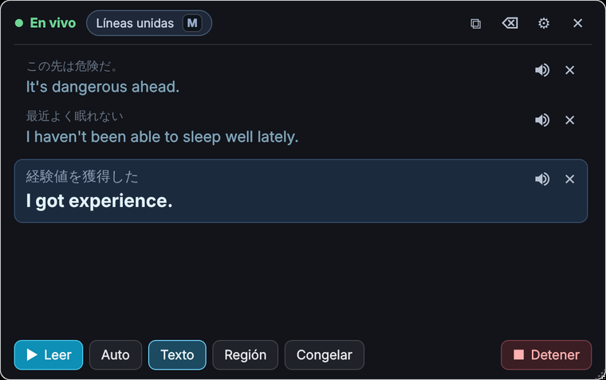
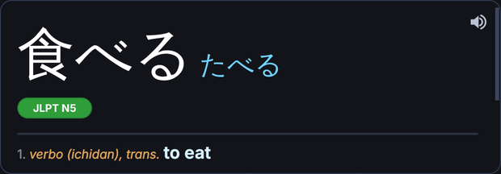
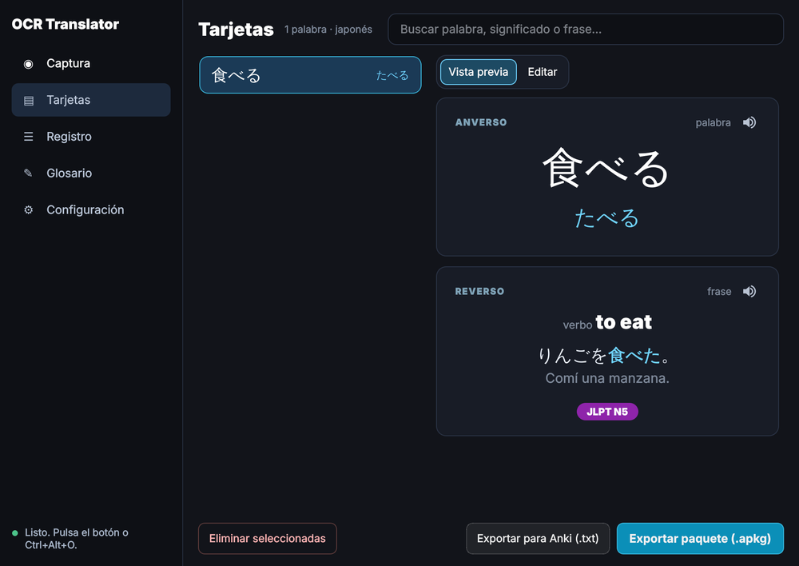
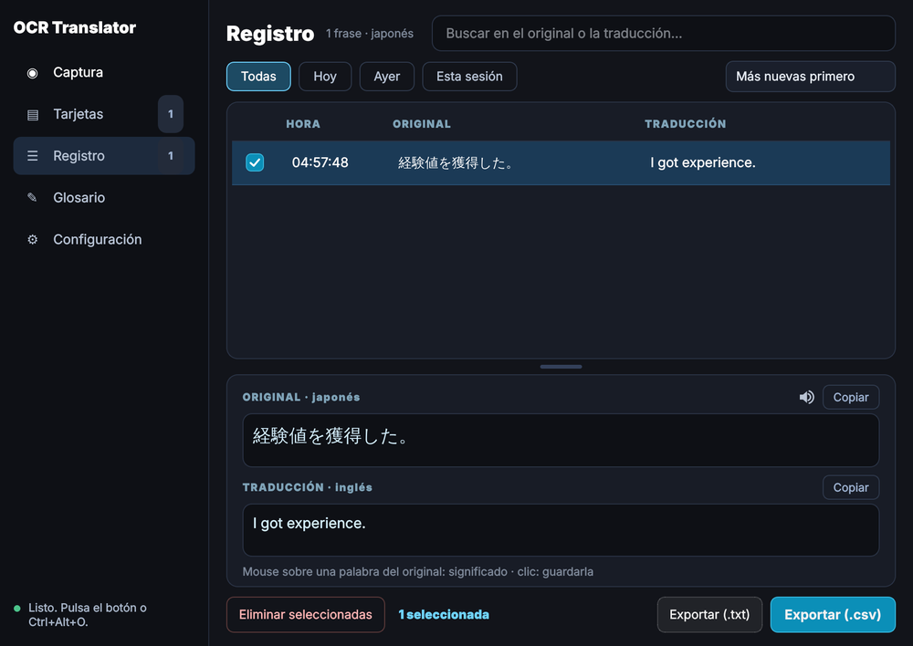
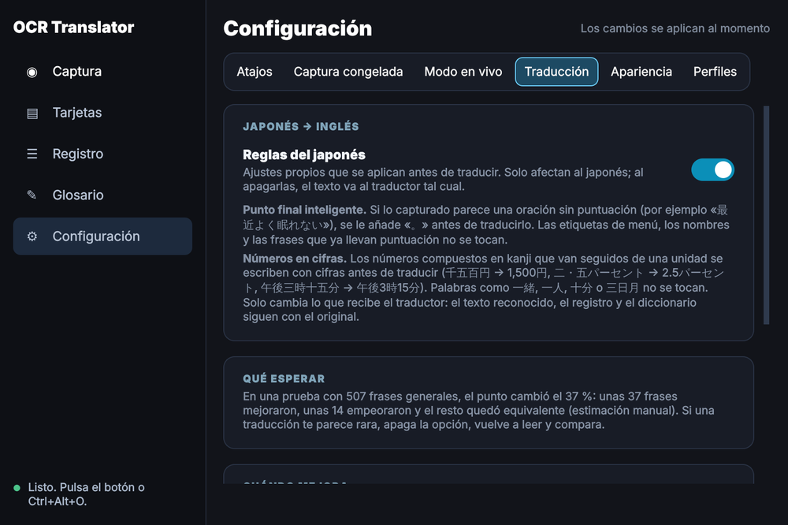
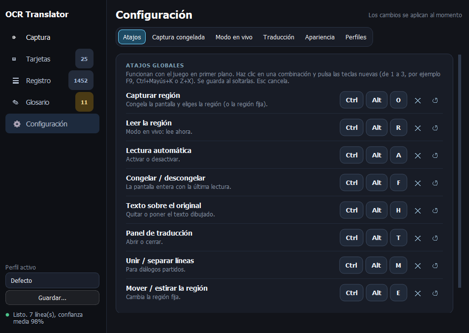

# OCR Translator

Lee el texto de un videojuego (novelas visuales, RPG, juegos con subtítulos…), lo **traduce**, te enseña el
**significado de cada palabra** al pasar el mouse y lo guarda en un **registro** y en **tarjetas de Anki**.
Todo corre en tu PC: sin cuentas, sin API de pago y pensado para gastar poco CPU mientras juegas.

> Lo más importante es el diccionario, no la traducción completa: la traducción automática te da la idea de la
> frase y, si alguna palabra sale mal, el diccionario de cada palabra lo compensa.

| Idioma del juego | Traduce a | Diccionario |
|---|---|---|
| Japonés | Inglés | JMdict (con niveles JLPT, frecuencias y gramática) |
| Inglés | Español | WordNet + Open Multilingual WordNet |
| Francés | Español | WikDict/FreeDict (Wiktionary) + WordNet |



## Qué hace

- **Dos formas de capturar**
  - **Captura congelada**: congela la pantalla, eliges una región y el texto reconocido se dibuja encima del
    original; el juego (o la cinemática) puede seguir sin que cambie lo que lees.
  - **Modo en vivo**: vigila una región fija y lee el texto cuando cambia (lectura automática cuando el texto
    se queda quieto, para no leer a medias el texto que sale letra a letra). Panel de traducción con tres aspectos
    (completo, mínimo y viñeta) y opción de pulsar la tecla de pausa del juego al congelar.
- **Diccionario bajo el mouse**: deja quieto el mouse sobre una palabra del texto y aparece su significado, lectura,
  nivel JLPT, frecuencias por tipo de medio (anime, videojuegos, novelas visuales…) y patrones de gramática.
  Clic para guardar la palabra; las que ya guardaste salen marcadas.
- **Japonés a fondo**: segmentación con Sudachi, formas conjugadas → forma de diccionario (incluye potenciales,
  causativos, pasivas…), tres modos de OCR (normal, solo kana y **vertical**), corrección de confusiones típicas del OCR y
  *reglas del japonés* opcionales (punto final inteligente y números en cifras) que mejoran la traducción.
- **Tarjetas y Anki**: cada idioma tiene su lista de palabras. Exporta a `.txt` o a un paquete `.apkg`, con el
  **audio de la palabra y de la frase** si quieres.
- **Voz**: botón 🔊 para escuchar palabras y frases con las voces que ya trae Windows (sin internet).
- **Registro** de todas las frases leídas, con filtros, búsqueda y exportación a `.txt` / `.csv`.
- **Glosario / Pendientes**: las palabras sin significado se apartan para rellenarlas a mano (o en una hoja de
  cálculo) y pasar a tarjeta.
- **Perfiles por juego**: región, idioma, modo de OCR, opciones del modo en vivo y tecla de pausa por juego.
- La propia app **no sale en las capturas** (Windows 10 2004 o superior), así que el OCR no lee su interfaz.

| Palabra al pasar el mouse | Tarjetas (vista previa) |
|---|---|
|  |  |



## Requisitos

- **Windows 10 (2004 o superior) / 11**. Es el sistema para el que está hecha; funciones solo de Windows: ocultar la
  app de las capturas, la voz, la tecla de pausa del juego y los atajos globales.
- **Python 3.13** (la versión con la que se desarrolla; 3.10+ debería servir).
- Espacio en disco: ~115 MB de diccionarios más los modelos de traducción (el de inglés pesa ~150 MB) y los de OCR. Conexión a
  internet **solo** la primera vez (modelos y datos).
- No hace falta GPU. Todo va en CPU.

## Instalación

```powershell
git clone https://github.com/Slovvan/Language_Learning_OCR_App.git
cd Language_Learning_OCR_App
python -m venv .venv
.\.venv\Scripts\Activate.ps1
python -m pip install -r requirements
```

### 1. Diccionarios y datos de japonés

Las bases principales de significados —`DB/data/dictionary.db`, `DB/data/dictionary_ja.db` y
`DB/data/dictionary_fr.db`— no están en el repositorio. Debes generarlas (ver [Generar los datos](#generar-los-datos)).

`DB/data/levels_ja.db` sí está incluido. Es una base auxiliar: añade los niveles JLPT y las frecuencias al diccionario
japonés, pero **no sustituye** a `dictionary_ja.db`. Con la base incluida no hace falta descargar los ZIP de jiten
para usar las frecuencias que ya contiene. Si falta `levels_ja.db`, la app sigue funcionando, pero no muestra esas
etiquetas.

Sin una de las bases principales, la app avisa de que no encuentra ese diccionario y no muestra sus significados.

### 2. Los modelos (automático)

La primera vez que eliges un idioma la app descarga su modelo de traducción a `Translator/models/` (el de inglés
pesa ~150 MB) y RapidOCR descarga sus modelos de reconocimiento de texto.

### 3. Ejecutar

```powershell
python -m UI.main
```

## Uso rápido

1. Elige el **idioma del juego** arriba a la izquierda (el perfil de OCR y el diccionario cambian con él).
2. **Captura congelada**: pulsa `Ctrl+Alt+O` (o «Capturar región»), arrastra un rectángulo sobre el texto y
   espera. El texto aparece sobre el original, con su traducción.
   **Modo en vivo**: elige «En vivo (región fija)», marca la región una vez y usa `Ctrl+Alt+R` para leer, o activa la
   lectura automática con `Ctrl+Alt+A`.
3. Deja el mouse quieto sobre una palabra para ver su significado; haz clic para guardarla.
4. Cuando tengas palabras, ve a **Tarjetas** y exporta a Anki.

### Atajos globales (se pueden cambiar en Configuración ▸ Atajos)

| Atajo | Acción |
|---|---|
| `Ctrl+Alt+O` | Capturar región / elegir la región fija |
| `Ctrl+Alt+R` | Leer la región (modo en vivo) |
| `Ctrl+Alt+A` | Lectura automática: activar / desactivar |
| `Ctrl+Alt+F` | Congelar / descongelar la pantalla |
| `Ctrl+Alt+H` | Quitar / poner el texto sobre el original |
| `Ctrl+Alt+T` | Abrir / cerrar el panel de traducción |
| `Ctrl+Alt+M` | Unir / separar líneas |
| `Ctrl+Alt+E` | Mover / estirar la región |

En la captura congelada: `Esc` cierra · `T` traducción · `O` texto sobre el original · `M` unir líneas ·
clic derecho: otra región · `1` / `2` / `3`: modo de OCR japonés (normal / solo kana / vertical).
Los atajos globales necesitan `pynput` (viene en `requirements`).

## Idiomas y modelos

| Par | Modelo de traducción | OCR |
|---|---|---|
| Inglés → Español | `michaelfeil/ct2fast-opus-mt-en-es` (Opus-MT, CTranslate2) | RapidOCR |
| Japonés → Inglés | `shift-ykurami/fugumt-ja-en-ct2-f32` (FuguMT, CTranslate2) | RapidOCR + correcciones y modos para japonés |
| Francés → Español | `gaudi/opus-mt-fr-es-ctranslate2` (Opus-MT; alternativo `michaelfeil/ct2fast-opus-mt-fr-es`) | RapidOCR (reconocedor de texto latino) |

Los modelos van con CTranslate2 en CPU (sin torch). Cada idioma tiene **sus propias** tarjetas, registro, pendientes y
mazo de Anki.

## Reglas del japonés (Configuración ▸ Traducción)

Dos ajustes que se aplican **solo a lo que recibe el traductor** (el texto reconocido y el registro no cambian) y que
se activan o desactivan con un interruptor (activadas de fábrica):

- **Punto final inteligente**: «最近よく眠れない» sin puntuación sale mejor con «。» al final. Solo se añade si el texto
  parece una oración; las etiquetas de menú y los nombres se quedan como están.
- **Números en cifras**: el modelo falla con los numerales en kanji. `千五百円` → `1,500円`, `三月十五日` → `3月15日`,
  `二・五パーセント` → `2.5パーセント`. Palabras como 一緒, 十分 (bastante), 三日月 o 万一 no se tocan.



Para medir el efecto con tu modelo real, desde la raíz del proyecto ejecuta
`python -m Tests.probar_reglas_ja Tests\frases_ja_numeros.txt` (o cambia el archivo por
`Tests\frases_ja_general.txt`, 507 frases). Genera `Tests\reglas_ja_resultado.csv` con la traducción base, con punto,
con números y con las reglas.

## Tarjetas y Anki

Los campos de cada nota:

| Idioma | Campos |
|---|---|
| Inglés / Francés | `Word · Meaning · Sentence · SentenceTranslation · Extra` |
| Japonés | `Word · Reading · Meaning · Sentence · SentenceTranslation · Extra` |

- **Paquete `.apkg`** (necesita `genanki`): crea su propio tipo de nota y mazo («OCR Translator», «… – Japonés»,
  «… – Francés»). Cada nota lleva un identificador estable: **reimportar actualiza** las notas en vez de duplicarlas.
- **Texto `.txt`**: se importa desde Anki (Archivo ▸ Importar) y asignas las columnas a los campos de tu tipo de nota.
- **Etiquetas**: `JLPT::N3`, `freq::anime::top_1500`…
- **Audio** (casilla «Incluir audio» al exportar): genera la voz de la palabra y de la frase *solo de lo que falta*,
  sin repetidos. En `.apkg` los sonidos van dentro; con `.txt` se crea una carpeta `<nombre>_audio` que debes copiar a
  `collection.media` de Anki. Con `lameenc` instalado van en MP3 (unas 10 veces más pequeños que el WAV).
  Las etiquetas `[sound:…]` se añaden dentro de campos existentes (Lectura o Significado, y la Frase), así tu tipo de nota no
  cambia.

## Voz

El botón 🔊 aparece en el popup de cada palabra, en cada frase del panel de traducción, en Tarjetas (vista previa y
editor), en Registro y en Glosario. Usa las voces de Windows (primero las del paquete de idioma y, si no hay, las
clásicas SAPI) mediante PowerShell, **sin internet**, y guarda cada audio en `UI/data/audio/` (tope 200 MB, borra lo más
viejo) para que la segunda vez suene al instante.

Si no hay voz del idioma, la app te dice dónde agregarla: *Configuración de Windows ▸ Hora e idioma ▸ Idioma y región ▸
(idioma) ▸ opciones ▸ Voz*.

## Configuración

Pestañas: **Atajos · Captura congelada · Modo en vivo · Traducción · Apariencia · Perfiles**. Todo se guarda al
momento. Los **perfiles** recuerdan, por juego, la región, el idioma, el modo de OCR, las opciones del modo en vivo y la
tecla de pausa.



## Generar los datos

Se ejecutan una sola vez, desde la raíz del proyecto y con el entorno virtual activo. Como los scripts están en el
módulo `DB`, ejecútalos con `python -m DB.<script>`:

| Archivo generado | Comando | Fuente |
|---|---|---|
| `DB/data/dictionary.db` (inglés) | `python -m DB.build_dictionary` | WordNet 3.0 + Open Multilingual WordNet (descarga ~40 MB a `DB/data/nltk_data/`; 1–3 min) |
| `DB/data/dictionary_ja.db` (japonés) | `python -m DB.build_dictionary_ja` | JMdict (`jmdict-simplified`); ~500 MB de RAM, 1–2 min. Con `--file DB\data\jmdict-eng-….json` usa un JSON ya descargado |
| `DB/data/dictionary_fr.db` (francés) | `python -m DB.build_dictionary_fr` | FreeDict/WikDict `fra-spa` (`fra-spa.index` y `fra-spa.dict.dz` en `DB/data/fr_source/`) + WordNet/OMW |
| `DB/data/levels_ja.db` (JLPT y frecuencias japonesas) | `python -m DB.build_levels_ja` | JLPT (incluido en `DB/data/jlpt_vocab_ALL.json`); las frecuencias de [jiten.moe](https://jiten.moe/frequency-dictionaries) son opcionales al generar la base |

#### Frecuencias de jiten (solo para crear o actualizar la base)

Si usas el `levels_ja.db` incluido, puedes saltarte esta sección: **no necesitas descargar las listas de jiten**.
Descárgalas únicamente si vas a crear una base propia o actualizar sus frecuencias. En cada fila de la página de jiten,
baja la versión «Yomitan» (`.zip`, no la descomprimas), guárdala en `DB/data/` y ejecuta el generador con todas las
listas que quieras incluir.
Por ejemplo, este comando carga videojuegos, anime, novelas visuales, dramas y la lista global:

```powershell
python -m DB.build_levels_ja game=DB\data\jiten_freq_VideoGame.zip anime=DB\data\jiten_freq_Anime.zip vn=DB\data\jiten_freq_VisualNovel.zip drama=DB\data\jiten_freq_Drama.zip global=DB\data\jiten_freq_global.zip
```

El generador **reconstruye `levels_ja.db` desde cero** en cada ejecución. Si quieres conservar frecuencias de una
ejecución anterior, vuelve a pasar también sus ZIP; las listas omitidas no se copian a la nueva base. Si ejecutas el
comando sin listas de jiten, la base resultante tendrá los niveles JLPT, pero no las frecuencias.

Archivos de datos que **sí** vienen en el repositorio: `DB/data/levels_ja.db` (niveles JLPT y frecuencias de jiten.moe),
`DB/data/grammar_ja.tsv` (patrones de gramática), `DB/data/fr_extra.tsv` (palabras extra del francés),
`DB/data/glosario_semilla_ja.tsv`,
`DB/data/jlpt_vocab_ALL.json` y los `DB/data/CREDITS_*.txt`.

## Tus datos y privacidad

- Todo se procesa en tu equipo. Internet solo se usa para **descargar** modelos y datos (Hugging Face, GitHub, RapidOCR).
  La voz es local y no se envía nada a ningún servicio.
- Tus palabras viven en `Cards/data/cards.db`; las frases y pendientes, en `DB/data/log.db` y `DB/data/glossary.db`; los ajustes, en el
  registro de Windows (`QSettings`, «OCRTranslator»).
- Las bases dañadas se apartan como `*.db.danada-FECHA` en lugar de borrarse.

## Estructura del proyecto

| Carpeta / archivo | Qué contiene |
|---|---|
| `UI/` | Aplicación principal (`UI/main.py`), captura, vistas, ajustes y modo en vivo |
| `OCR/` | Motor de reconocimiento de texto |
| `Translator/` | Traducción, paquetes de idioma y reglas; modelos descargados en `Translator/models/` |
| `DB/` | Diccionarios, gramática y acceso a datos; bases y recursos en `DB/data/` |
| `Cards/` | Tarjetas, frases y exportación a Anki; datos de tarjetas en `Cards/data/` |
| `Tests/` | Pruebas, benchmarks y herramientas de comparación |

## Problemas frecuentes

- **«Diccionario no encontrado»**: falta el `.db` de ese idioma, genera `DB/data/dictionary*.db`.
- **El atajo global no funciona**: instala `pynput` (`pip install pynput`) y evita combinaciones que use otro programa; puedes
  cambiarlo en Configuración ▸ Atajos.
- **🔊 no suena o avisa de que no hay voz**: instala la voz del idioma en Windows (ver *Voz*). La primera vez de cada texto
  tarda ~1 s.
- **Falla la descarga de un modelo**: revisa la conexión o el proxy y vuelve a intentarlo.
- **El OCR vertical se equivoca en kana pequeños** (っ, ゃ): es una limitación del reconocedor; la app ya rellena el recorte
  para mejorarlo, pero puede quedar algún error. Repite la lectura o ajusta la región.
- **Traducciones raras en japonés**: son errores del modelo (también salían sin las reglas). El diccionario de cada palabra
  está para eso; prueba a apagar «Reglas del japonés» para comparar.

## Licencias y atribuciones

**Datos y modelos** (resumen; los detalles están en `DB/data/CREDITS_fr.txt` y `DB/data/CREDITS_levels.txt`):

- **JMdict** © Electronic Dictionary Research and Development Group (EDRDG), CC BY-SA 4.0 —
  <https://www.edrdg.org/edrdg/licence.html>. Versión «jmdict-simplified» de scriptin.
  `dictionary_ja.db` es una obra derivada: se comparte con la misma licencia.
- **WordNet 3.0** © Princeton University (licencia permisiva) y **Open Multilingual WordNet**; español del
  Multilingual Central Repository (CC BY 3.0); francés **WOLF** (Inria, CeCILL-C).
- **FreeDict / WikDict `fra-spa`** (Wiktionary / DBnary), CC BY-SA 3.0. `dictionary_fr.db` se comparte con esa licencia.
- **Nivel JLPT**: lista de Jonathan Waller (<https://www.tanos.co.uk/jlpt/>, CC BY) en el formato JSON de Bluskyo
  (MIT). No es una lista oficial: el JLPT no publica vocabulario por nivel desde 2010.
- **Frecuencias**: [jiten.moe](https://jiten.moe/frequency-dictionaries), CC BY-SA 4.0 (datos de JMdict/EDRDG).
- **Modelos de traducción**: Opus-MT (Helsinki-NLP, CC BY 4.0) convertidos a CTranslate2 por sus autores; FuguMT
  (japonés → inglés, convertido a CTranslate2). Revisa la tarjeta de cada modelo en Hugging Face para su licencia vigente.
- **Software**: RapidOCR / PaddleOCR (Apache 2.0), CTranslate2 (MIT), SudachiPy y SudachiDict (Apache 2.0),
  simplemma (MIT), genanki, onnxruntime, OpenCV, NumPy, mss, pynput, lameenc.
